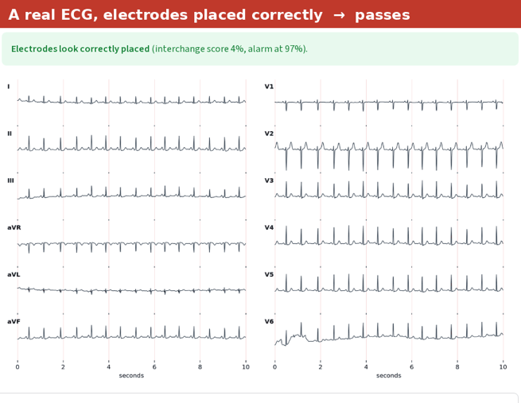
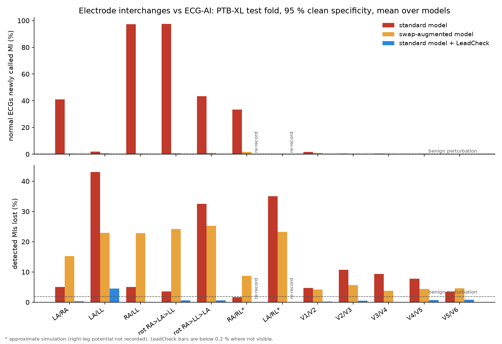

# ECG LeadCheck

[](https://github.com/hxlvvm/ECG-LeadCheck/actions/workflows/tests.yml)

**A deep-learning model that catches swapped electrodes in 12-lead ECGs, trained on real recordings with
physics-based simulation of the mistakes.**



## Why

If two ECG electrodes are attached to the wrong places, every lead computed from them changes. An arm swap
inverts lead I and can look like a lateral infarction or dextrocardia. A chest swap breaks the R-wave
progression and can mimic an old anterior infarct. The recording looks plausible, so the mistake is easy
to miss and can lead to a wrong diagnosis.

## How it works

**Simulated mistakes from real ECGs.** No hand labelling is needed.
- A 12-lead ECG fixes the potentials of the three limb electrodes: RA = 0, LA = I, LL = II.
- Re-attaching the cables to other sites and recomputing the six limb leads gives the exact recording a
  limb interchange would have produced. The chest leads are referenced to the Wilson terminal, which does
  not change under a limb permutation.
- Chest swaps exchange two channels.
- Interchanges with the right-leg (ground) electrode need its unrecorded potential. It is approximated by
  the left leg, so those two classes are marked approximate.
- See [`swaps.py`](src/leadcheck/swaps.py); its unit tests check Einthoven's law and the inverse of every swap.

**Twelve interchange classes plus "none":**
- limb pairs: LA/RA, LA/LL, RA/LL;
- the two limb rotations;
- RA/RL and LA/RL;
- the five adjacent chest pairs, V1/V2 to V5/V6.

**Model.** A small 1D ResNet (about 2 M parameters) over 10 s at 100 Hz. Training took about 2 minutes on
one GPU.

**Data.** [PTB-XL](https://physionet.org/content/ptb-xl/1.0.3/): 21,799 real 12-lead ECGs. Official folds:
train on 1-8, set the alarm threshold on 9, test on 10. The thresholds and targets were written down
([`GATE.md`](GATE.md)) before any model was trained.

## Results on 2,198 ECGs the model never saw

Every recording was tested under every interchange. The alarm threshold gives **one false alarm per 100
correctly recorded ECGs** (98.9 % specificity on the test fold).

| interchange | caught (CNN) | caught (correlation-feature baseline) |
|---|---|---|
| limb: LA/RA, RA/LL, rotations | **99.6 %** | 96.0 % |
| limb: LA/LL, the hardest | **94.0 %** | 24.2 % |
| right-leg (ground) interchanges, approximate | 100 % | 100 % |
| adjacent chest electrodes | **93.0 %** | 78.0 % |
| type named correctly when flagged | **99.5 %** | 92.9 % |

Per-class numbers, with AUROC from 0.991 to 1.000, are in [`GATE_RESULT.md`](GATE_RESULT.md).

**For context.** A published inter-lead correlation method (Jekova et al., *Comput Methods Programs Biomed*
2016) reports 95.5-96.9 % for limb reversals and 93.8-97.8 % for adjacent chest swaps, at more than 99 %
specificity on a different test set. My baseline uses correlations in the same spirit but is not a
reimplementation of their rules. So the fair claim is that this model is **in the same range as the
published method**, and clearly ahead of a correlation-feature model on identical data. It also names the
type of mistake.

## Study: do swapped electrodes fool ECG diagnosis AI?

LeadCheck is also the guard in a small study ([`study/`](study/)). It asks how electrode interchanges affect
deep-learning ECG *diagnosis* models, and whether detecting and undoing the interchange fixes them. I found no
earlier study that measures this ([`study/PRIOR_ART.md`](study/PRIOR_ART.md)). A 2021 commentary by Bond et al.
called for exactly this kind of stress test of ECG-AI models.

**Setup**
- Eight models on the standard PTB-XL five-class task (normal, MI, ST/T change, conduction disturbance, hypertrophy):
  ResNet and InceptionTime, two seeds each, trained either on clean ECGs or with random interchanges.
- Clean macro-AUROC 0.921-0.927.
- The plan was committed before training ([`study/PLAN.md`](study/PLAN.md)). It was amended once, after an
  independent methodological review and before the reported run; the first run is kept in `study/archive_v1/`.



**Results on PTB-XL fold 10** (2,158 recordings, 1,877 patients; full tables with counts and intervals in
[`study/RESULTS.md`](study/RESULTS.md)):

- **Accuracy drop.** An LA/RA (arm) interchange lowers the standard models' macro-AUROC by 0.136-0.147
  (patient-bootstrap 95 % CIs within 0.125-0.157). RA/LL and one limb rotation push MI detection to chance
  level: MI AUROC 0.47-0.58.
- **False and missed MI.** At a fixed operating point (95 % specificity on clean data):
  - LA/RA makes the standard models call MI on 26-58 % of normal ECGs, and RA/LL on 92-100 %.
  - LA/LL hides 35-53 % of the MIs they had detected.
  - A benign perturbation (noise plus a 30 ms shift) causes 0-0.3 % false MI.
- **LeadCheck in front (detect and correct).**
  - Newly called MI stays at 0.1 % or below, and lost MIs at 4.5 % or below.
  - 0.2-2.8 % of diagnoses change.
  - It changes 0-0.2 % of diagnoses on correctly recorded ECGs.
  - Right-leg interchanges cannot be undone, so they are routed to re-recording.
- **Training with interchanges instead.** This keeps false MI at 2.2 % or below. But the augmented models
  still lose 10-32 % of their detected MIs under limb interchanges, so augmentation alone is not a full fix.

**Caveats**
- The interchanges are simulated on real recordings, and the detector shares that simulator. For exact
  interchanges, recovery is therefore bounded by LeadCheck's detection and typing accuracy, by construction.
- At a 2 % interchange prevalence, about 65 % of LeadCheck's flags would be true interchanges.
- One dataset. Real interchanged recordings from other hospitals have not been tested.

## A real-world check

PTB-XL's own reports mention suspected electrode problems for a handful of recordings. I scored every
recording with a model that never trained on its fold:

- **Record 1853.** The cardiologist wrote that a "V1/V2 lead interchange" was a possible cause of the
  pattern. The model independently ranks it **43rd of 21,799**, with "V1/V2 swapped" at 98 %. Applying
  a V1/V2 swap to it clears the alarm, which is what you would expect if the electrodes were already swapped.
- **Two recordings noted "arm electrodes possibly interchanged".** The model leans LA/RA on one
  (score 0.32, below the alarm) and not on the other.
- **Across all 21,799 recordings,** 0.95 % are flagged, which matches the expected false-alarm rate.

The two strongest LA/RA-type flags describe extreme right-axis deviation, a known look-alike of an arm
swap. None of this is confirmed by a cardiologist.

## Limits

- **Interchanges only.** Electrodes shifted to the wrong intercostal space cannot be simulated from 12 leads.
- **Simulated test mistakes.** The test mistakes are simulated on real recordings, not collected prospectively.
- **One dataset, one device family.** It has not yet been tested on other hospitals' ECGs.
- **Research prototype**, not a medical device.

## Run it

```bash
pip install -r requirements.txt
streamlit run app.py          # demo (ONNX model, CPU only)
python -m pytest -q tests     # unit tests
```

**Checkpoints.** The detector and the eight study models are attached to the GitHub release `v2`. With them,
`scripts/diag_study.py` reproduces `study/results.json` exactly.

**Rebuilding from scratch.** `W=/some/dir ./run_all.sh` downloads PTB-XL, checks its checksums, then trains
and evaluates the detector and the study models. It needs Python 3.12, `requirements-train.txt` and a CUDA GPU.
Training uses seeded augmentation and deterministic kernels, so a retrain matches the released checkpoints
within normal run-to-run variation, not bit for bit.

## Data and licence

- **Data.** PTB-XL 1.0.3, CC BY 4.0. Wagner P, Strodthoff N, Bousseljot R-D, et al. PTB-XL, a large
  publicly available electrocardiography dataset. *Sci Data* 7, 154 (2020). Distributed by
  [PhysioNet](https://physionet.org) (Goldberger et al., *Circulation* 2000). The demo bundles 20 test-fold
  recordings under the same licence.
- **Code.** MIT.
